# STP10 in the desktop app

This walkthrough prepares *Arabidopsis thaliana* STP10 (PDB 7AAQ) in the desktop app: Visualize, MemPro, Preparation, Builder, Equilibration, Tools, and Analysis. The same system from Python is [STP10 with the API](7aaq-api.md).

Set a writable working directory in the top bar before MemPro, Preparation, Builder, or Equilibration.

## 1. Visualize

The app opens on Visualize.

In the PDB box at the bottom of the window, type `7AAQ` and press Enter, or click **↓ PDB**. A file already on disk is **Open → Structure**.

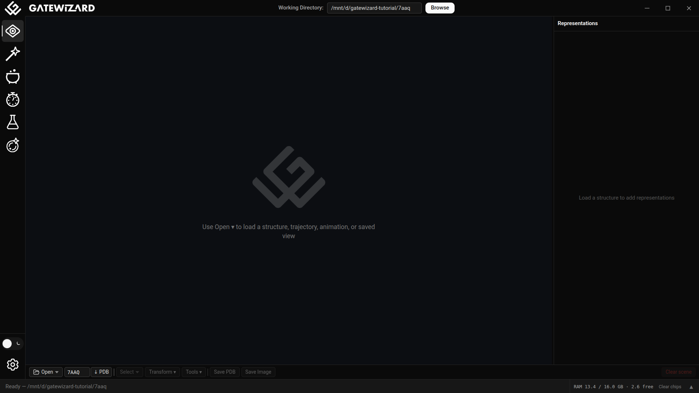

Rotate, pan, and zoom. The reference axes sit in the bottom-left corner.

Open **View Settings**, or choose **Auto Generate Representation** in the Representations panel.

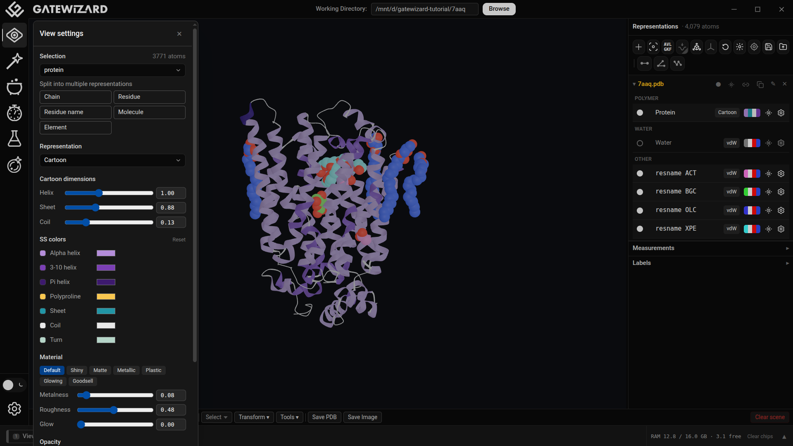

Show or hide protein, water, ligands, and lipids, and change the representation and color of each.

Selection covers atoms, residues, chains, and molecules. Chain names, residue names, and residue numbers can be edited from that same panel.

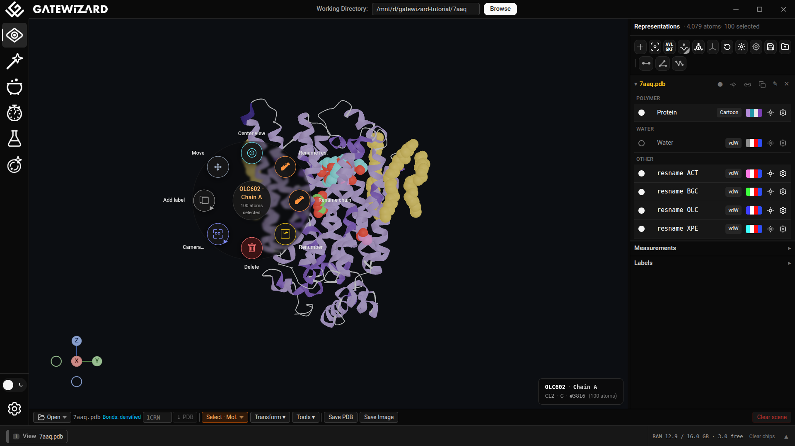

Keep the protein and the bound sugar BGC. Delete the monoolein (OLC), the water, the PEG detergent (XPE), and the acetate (ACT). Hiding a component first makes the next selection easier.

Save the structure as `7aaq_ligand.pdb`.

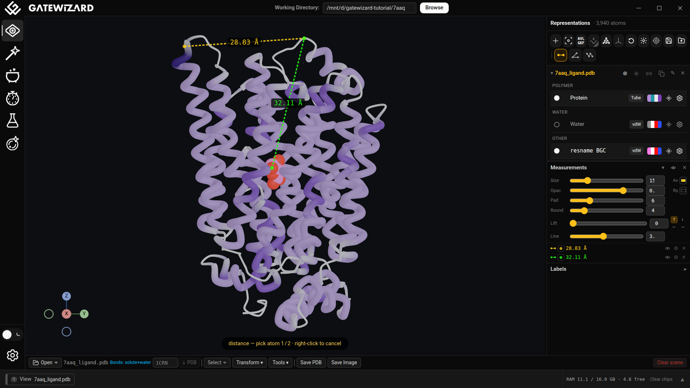

The measurement tools report distances and angles between selected atoms. Mutate Residue, Split Chain, and the animation tools are on this page when you need them. A rendered image uses the representation already on screen.

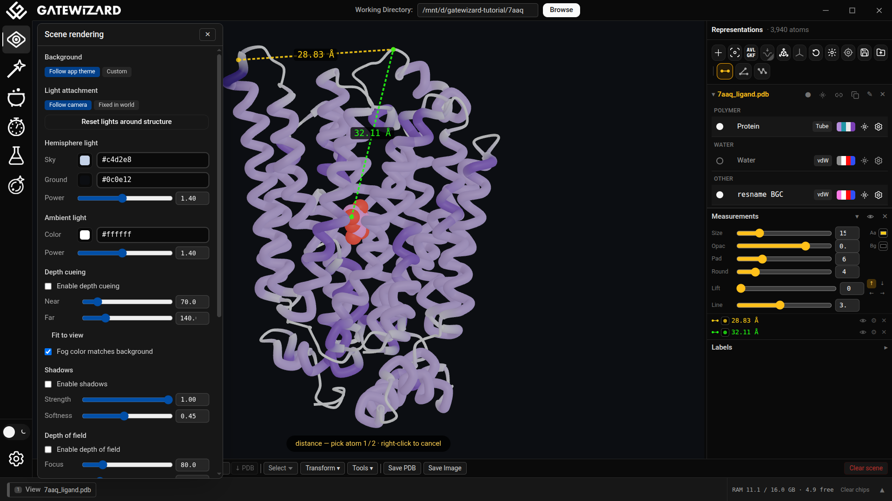

The helix bundle is still tilted. For a membrane protein those helices should run along the membrane normal, which here is Z. On the right-hand toolbar, click **Show axes lines**. The small axes in the corner and the long lines through the protein make the tilt easy to see. Packmol-memgen can estimate an orientation when it builds the bilayer. This walkthrough sets the pose with MemPro first, so you can look at it and keep the one you want before the membrane is added.

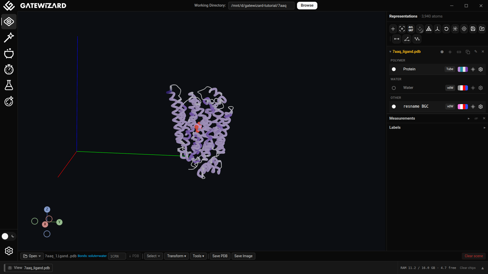

Open **Tools → MemPro orientation**.

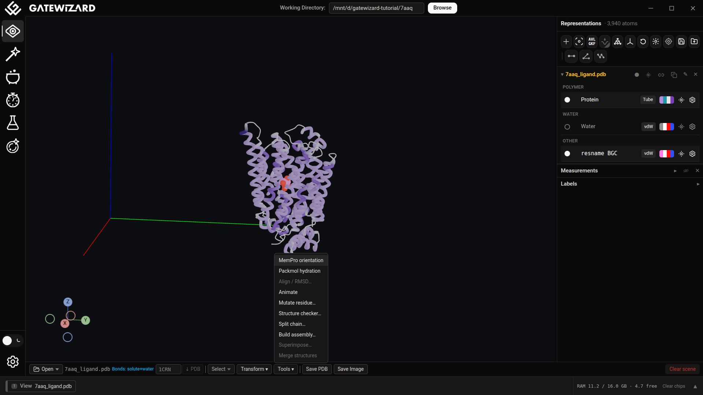

The dialog runs on `7aaq_ligand.pdb`. Leave the starting values: 150 iterations, grid size 36, membrane thickness **auto**, CPU count at the MemPro default, and Seed empty. Click **Run MemPro**.

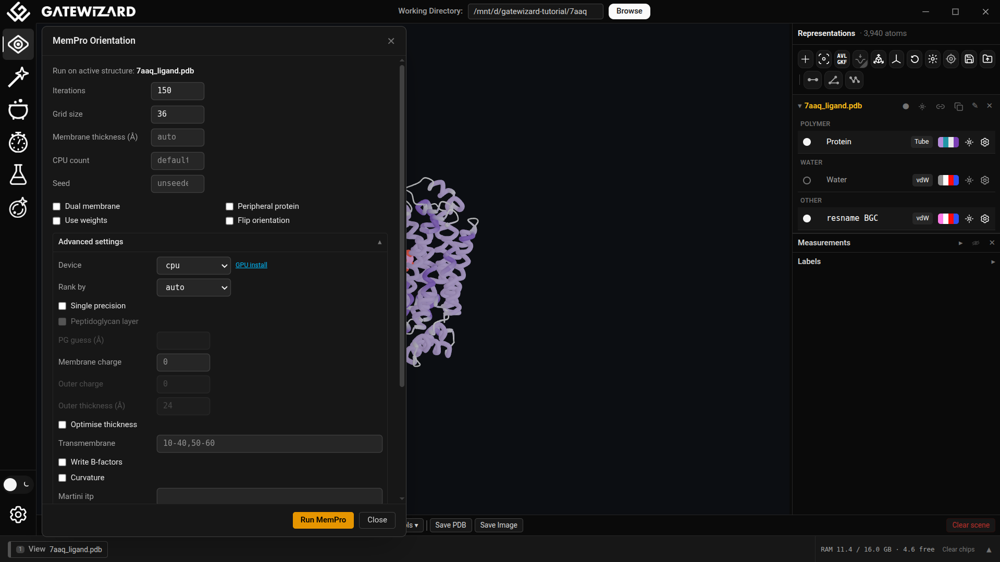

When the run finishes, rank 1 is the pose to keep. **Apply to** stays on `7aaq_ligand.pdb` (source), so BGC moves with the protein. Click **Apply**.

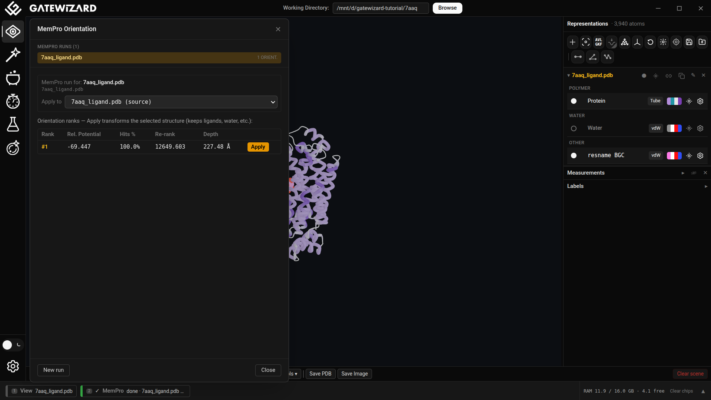

The bundle now lies along Z. Save the structure as `7aaq_ligand_oriented.pdb`.

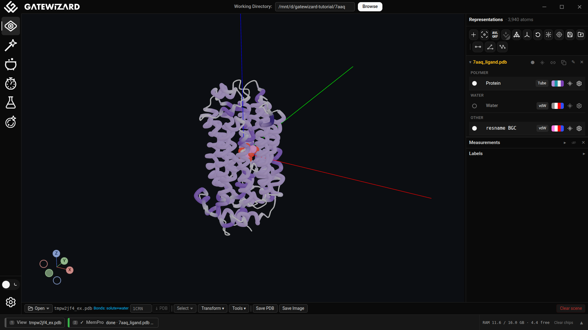

Open the structure checker on that file. The summary is 0 missing atoms, 0 missing residues, 0 breaks, and 0 alternate conformations. The two Other lines are expected here: BGC is the bound sugar, and the protein has no hydrogens yet. Preparation adds those hydrogens.

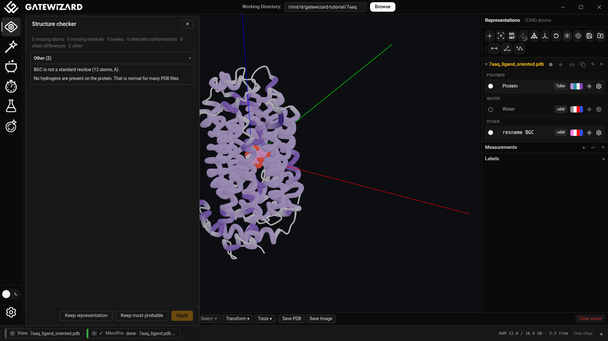

Open the sequence viewer. Chain A is one continuous sequence. ASP42 is a residue that is present. Amber protonation names appear only after Preparation.

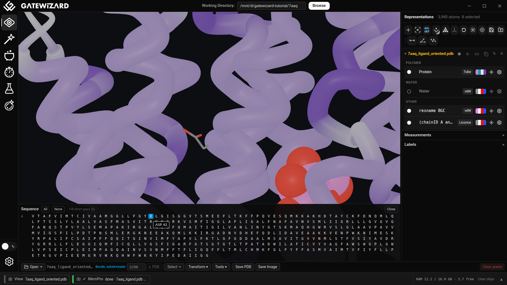

## 2. Preparation

Open Preparation and load `7aaq_ligand_oriented.pdb`.

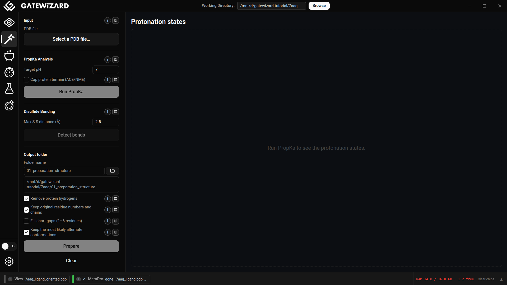

Set the target pH to 6. Turn on **Cap protein termini (ACE/NME)**. That box starts off. Click **Run PropKa**.

The table lists the ionizable residues at that pH. A histidine is HIP when the pH is below its pKa, and HIE otherwise. For this tutorial, change every histidine listed as HIP to HID. Clicking a row focuses that residue, and a changed state previews the hydrogens Prepare will add or remove. That 3D picture is an estimate. The hydrogen positions can shift a little once Amber rebuilds them.

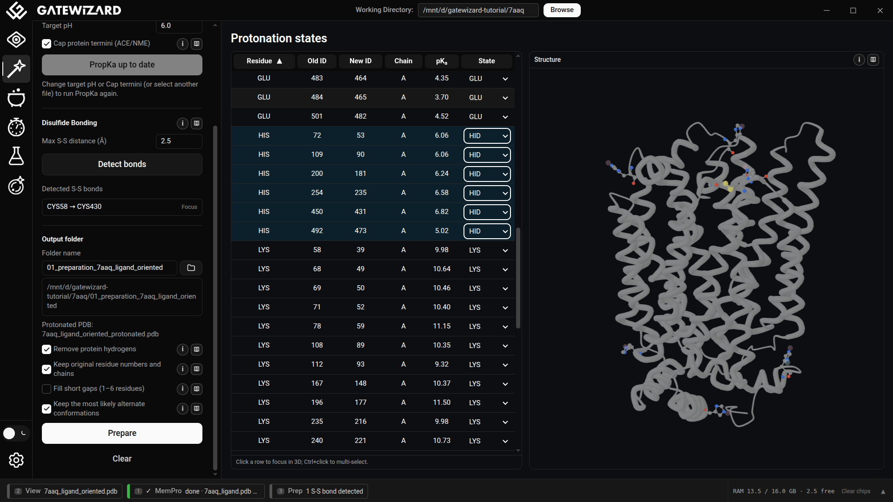

Leave **Remove protein hydrogens** on. The box starts on. The prepared PDB then keeps the heavy atoms and the residue names, and the protein hydrogens are left out. Ligands such as BGC keep theirs. This is safe for the membrane build because packmol-memgen adds the protein hydrogens again. What has to be kept is the name PropKa assigned, such as HID, ASH, GLH, or CYX. The final system follows those names when it places the hydrogens.

Click **Detect bonds** and confirm the disulfide between CYS58 and CYS430. After PropKa, that pair is drawn on the structure.

Name the output folder, or keep the default `01_preparation_7aaq_ligand_oriented`. Click **Prepare**. The prepared file is named from the input stem, so this save writes `7aaq_ligand_oriented_protonated.pdb` inside that folder.

Leave **Keep original residue numbers and chains** on. That is the desktop default. The [API study case](7aaq-api.md) turns it off and uses sequential Amber numbers.

## 3. Builder

Open Builder. Click **Select a PDB file…** and load `7aaq_ligand_oriented_protonated.pdb`.

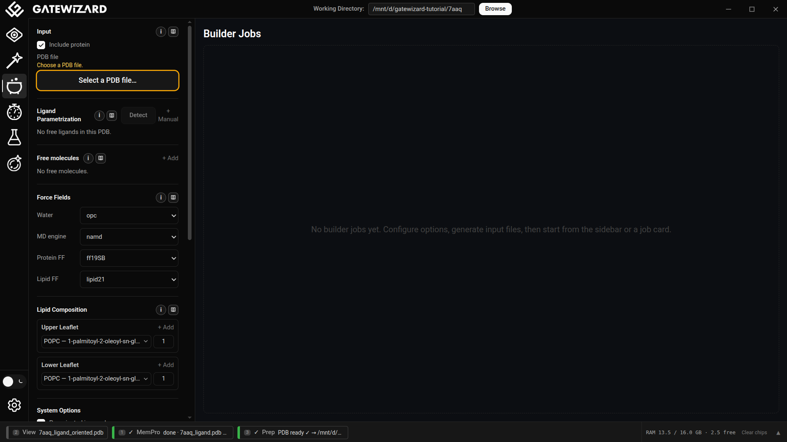

Parametrize BGC with the values already on the ligand card: GAFF2, ABCG2, and charge 0. Leave **Timeout** unchecked so antechamber runs until it finishes. The button reads **Parametrize BGC**. After it finishes, the card says **Done**.

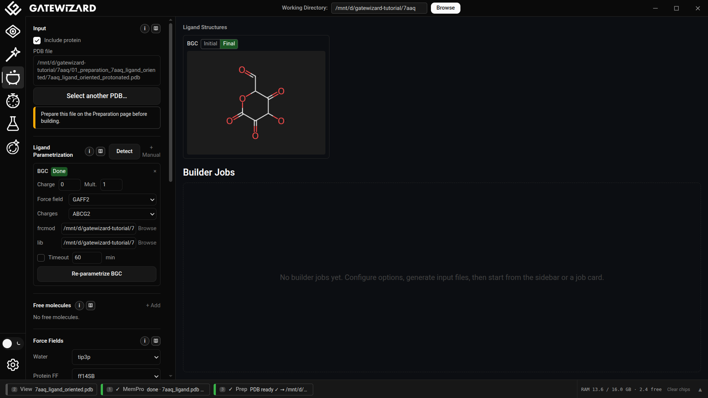

In Force fields, set:

- Water model: TIP3P
- Protein force field: ff14SB
- Lipid force field: Lipid21

Use POPC in both leaflets. Turn on **Add bulk salt**, set 0.15 M, and keep K+ and Cl−. Leave **Pre-oriented in membrane** on. MemPro already placed the protein, so the build skips MEMEMBED. That box starts on. Water thickness stays 26 Å and the boundary distance stays 12 Å.

Open **Advanced settings** and leave both boxes on. They start that way. **Parametrize with tleap** makes this job write `system.prmtop` and `system.inpcrd` after the membrane is packed, which is what Equilibration loads. **Skip protonation** keeps the names Preparation already chose, such as HID, ASH, GLH, and CYX. Those names are the protonation the final system follows. Packmol-memgen writes the protein hydrogens from the Amber template for each name, which is why leaving **Remove protein hydrogens** on during Preparation is safe.

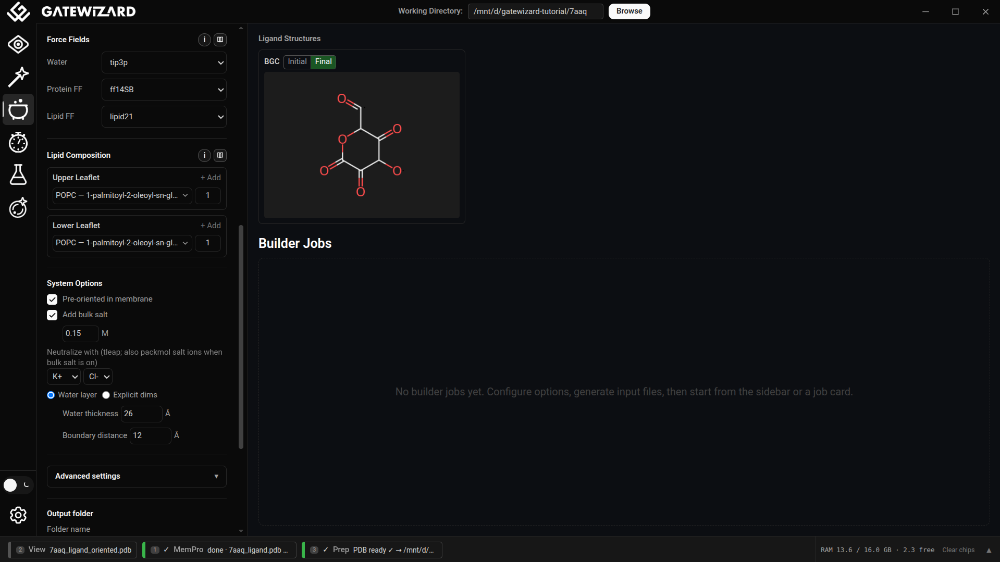

Click **Generate Input Files**, then **Build system**. The card for a job that is already generated still says **Start**. A folder that already contains a build keeps **Generate Input Files** off until you choose **Re-run** or the next number, such as `02_build_7aaq_ligand_oriented_protonated_2`. A new name generates immediately.

The folder is `02_build_7aaq_ligand_oriented_protonated`.

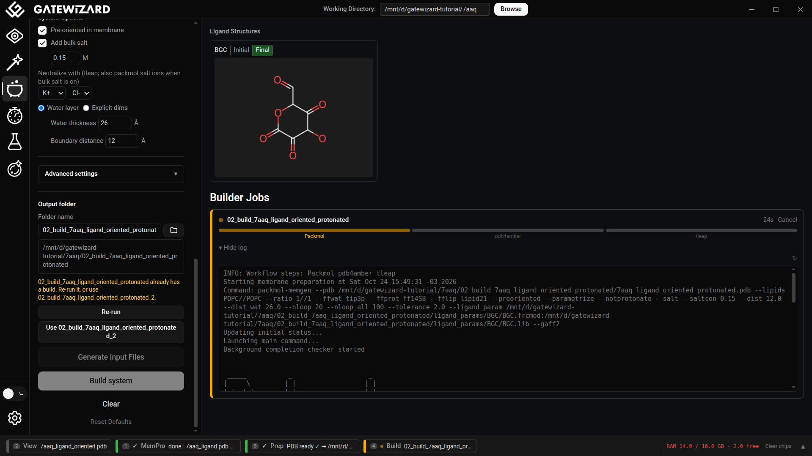

Packmol, pdb4amber, and tleap finish on the same card. A finished job contains `system.pdb`, `system.inpcrd`, and `system.prmtop`. Open `system.pdb` in Visualize.

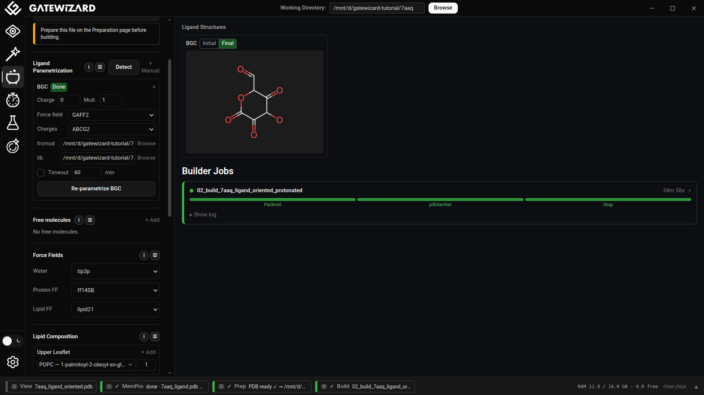

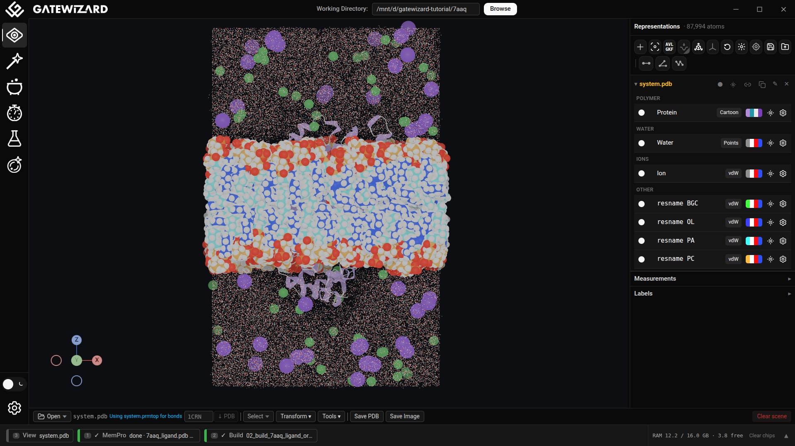

## 4. Equilibration

Open Equilibration and select the build folder. The page reads `system.prmtop` and `system.inpcrd` and shows the atom count.

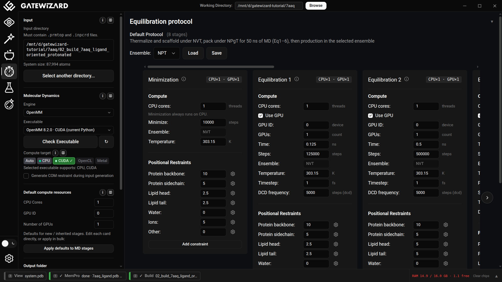

Set the engine to OpenMM. Its executable is Python. Leave the ensemble on **NPT**, where that menu starts, so production follows NPT. The protocol cards are Minimization, Equilibration 1–6, and Production. Minimization is 10,000 steps. Equilibration 1 and 2 stay NVT. Equilibration 3 through 6 pack the membrane under NPgT. The Production card starts at 100 ns. For this tutorial, set it to 200 ns.

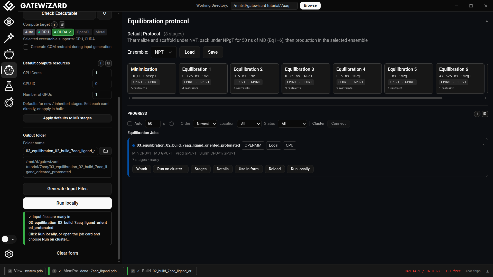

Leave the other stage settings as they are. Choosing OpenMM sets the sidebar to 1 CPU and 1 GPU. Under **Compute target**, a small green dot means this local executable can run that platform. Turn on a GPU target that shows the dot, usually **CUDA**, so the molecular-dynamics stages use the GPU. OpenMM writes the minimization steps into `step1_equilibration.inp`. Leave **Generate COM restraint** off, so no center-of-mass or rotation restraint is written.

Click **Generate Input Files**. The folder name is `03_equilibration_` plus the build folder name. It contains `step1_equilibration.inp` through `step6_equilibration.inp`, `step7_production.inp`, `run_equilibration.sh`, and `run_equilibration_cluster.sh`.

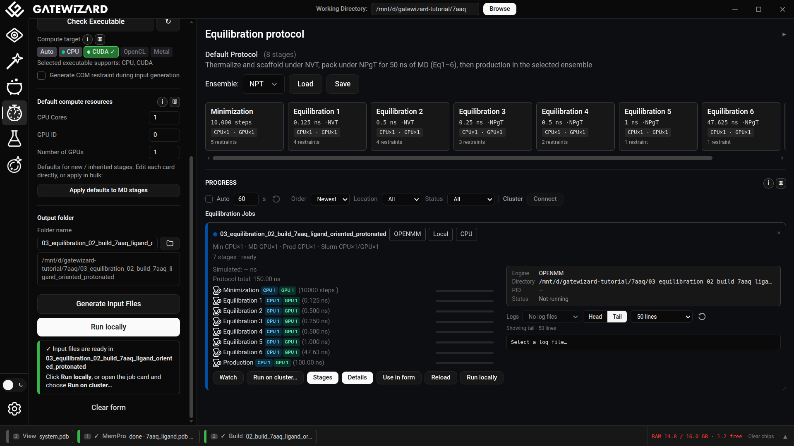

Run the job on this machine, or open Settings → Clusters and choose **Run on cluster**. The job card shows the log and the status of each stage.

## 5. Tools

Open Tools. Under **Fix PBC**, load the topology and the OpenMM trajectory. Set the periodic-boundary options so the system is rebuilt and centered. OpenMM trajectories use `cpptraj autoimage`.

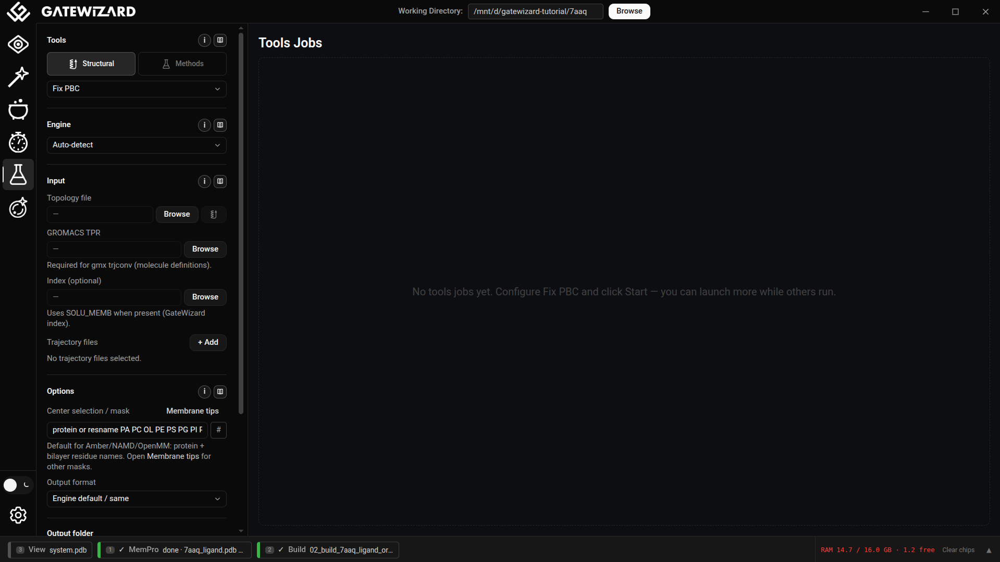

Choose the output directory and click **Start Fix PBC**. Use that trajectory in Visualize or Analysis.

## 6. Analysis

Open Analysis and choose **Structural**. Load the topology and the trajectory files. Each file needs the simulation time for that stage. Click **Protocol times** to fill those boxes from the default protocol, then change any value that does not match the run you did. Set the stride above 1 to keep every Nth frame and finish the analysis sooner.

Choose RMSD. Use the selection `protein and name CA` and turn structural alignment on. Use a reference PDB for the comparison. Frame 0 is whichever frame was written first, so two replicas can start from different coordinates. The same reference PDB keeps one structure for every run. Click **Run Analysis**.

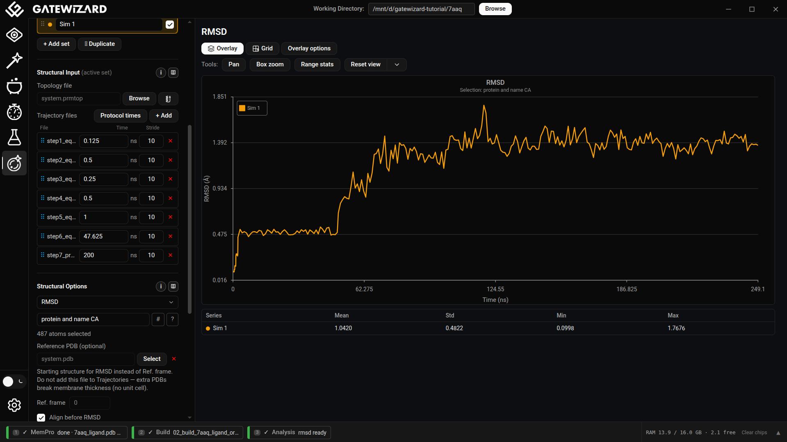

The x-axis stops short of 250 ns because the stride keeps every Nth frame, so the last point is the last frame that was kept. The run itself is 250 ns. In the plot settings, set the x-axis limit to 250 ns.

**Energetic**, with the engine set to OpenMM, reads the log files. Temperature, pressure, volume, and total energy are the usual traces. Titles, colors, units, and axis ranges are edited on the plot, and the figure or the data can be exported.

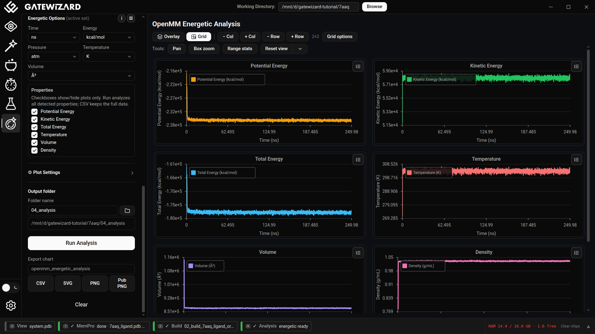

Stay on **Structural** and choose **Titration**. This reads one PDB. Browse `7aaq_ligand_oriented.pdb` and leave the target pH at 6, the same pH used in Preparation.

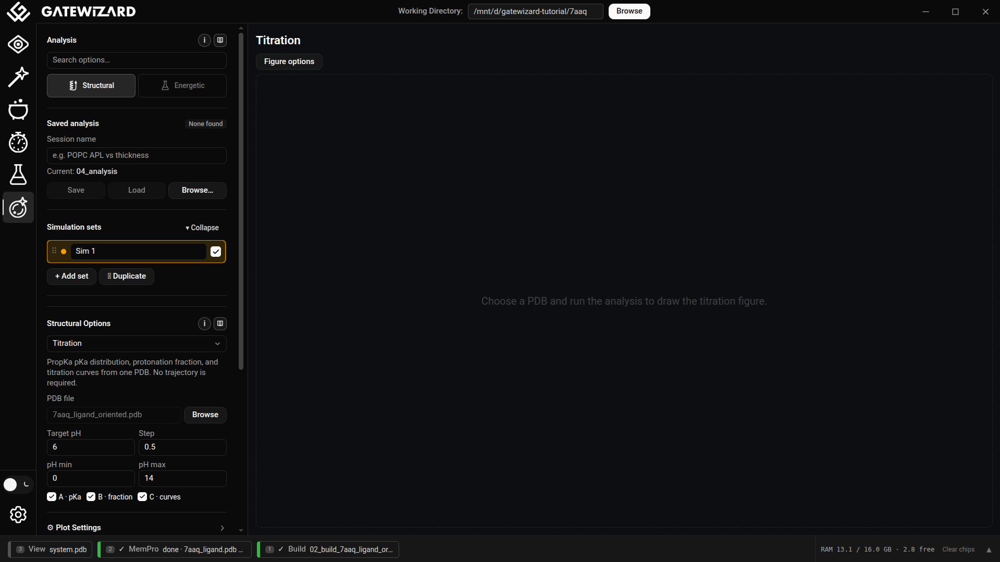

Click **Run Analysis**. Panel A is the pKa comparison, panel B is the protonated fraction, and panel C is the titration curves. Cysteines that form the disulfide stay out of A and B.

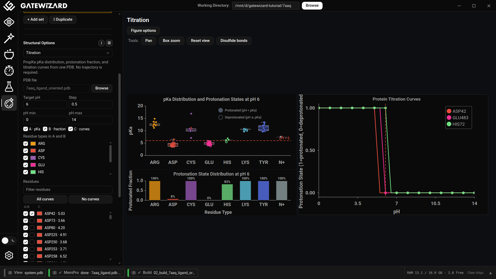
