# User Guide

This guide matches the **[gatewizard-gui](https://github.com/franciscoadasme/gatewizard-gui)** desktop app (Electron). The `gatewizard` pip package is the Python API only — it does not open this window.

## Pages

The left **activity bar** switches pages:

| Page | What it does |
|------|----------------|
| **Visualize** | 3D structures, trajectories, representations, sequence and short loops, structure checker, minimize, mutate / split / superimpose, figures and movies |
| **Preparation** | PropKa pKa table, protonation, disulfide bonds, ACE/NME caps, short loops, alternate conformations, inline 3D |
| **Builder** | packmol-memgen leaflets, salt, ligand force field and charges, tleap, job cards |
| **Equilibration** | NAMD / GROMACS / OpenMM / Amber schemes, Generate, Watch / Pull, cluster |
| **Tools** | Fix PBC and other trajectory utilities |
| **Analysis** | Structural (RMSD/RMSF/APL) and energetic log plots |

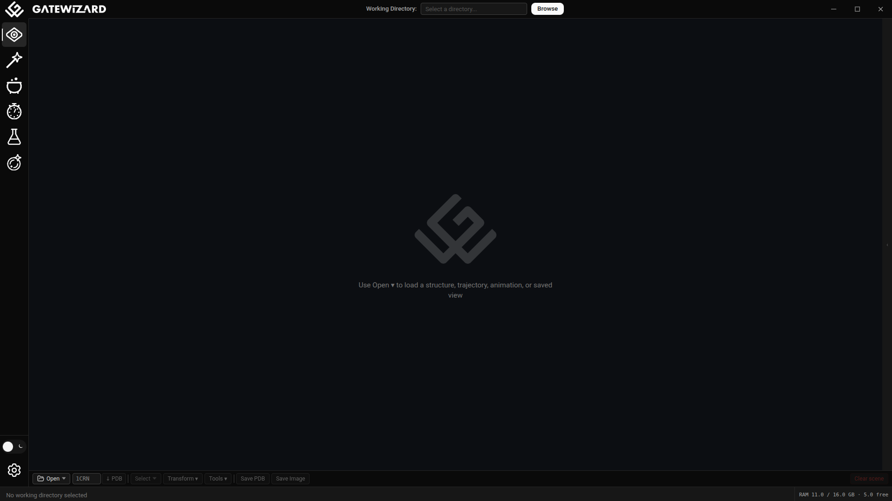

*Visualize workspace*

## Visualization

The bottom toolbar opens on a click. Open, Select, Transform, and Tools each stay closed until you click that button. Clicking another one closes the menu that was open. Click outside, press Escape, or scroll the toolbar to close it.

**Open** loads a structure (PDB, mmCIF, Maestro `.mae` / `.maegz`, GROMACS `.gro`, MOL2, SDF/SD, or XYZ), a topology (PRMTOP, PARM7, PSF, TOP, or GROMACS `.tpr`) plus coordinates (including Amber `.inpcrd` / `.rst7` with a matching topology), a trajectory, a saved animation, or a saved view. A multi-CT Maestro file or a multi-molecule SDF opens an entry picker. Same-stem companions such as `name.gro` + `name.tpr` or `name.pdb` + `name.prmtop` are detected automatically; **Coordinates only** opens the coordinate file without that companion. The score column and the line under each loaded pose name the property (for example **MMGBSA ΔG bind**). Auto uses MMGBSA ΔG bind, then docking score, Glide gscore, Prime energy, or the first other real score; **Show score** in the picker (or **On structure rows** in the properties table) picks another property. The list-ordered toolbar button opens the full table. API: [`list_maestro_entries`](api/maestro.md#list_maestro_entries) and [`read_maestro_properties`](api/maestro.md#read_maestro_properties). **Clear scene** removes the structure and the representations. The four-letter box next to Open downloads an RCSB entry (PDB, or mmCIF when RCSB does not publish a PDB).

**Select** turns on interactive selection for the structure named on the button. The level is atom, residue, chain, or molecule. Hovering the structure highlights that group. A left click keeps the selection. **Custom (MDAnalysis…)** types a selection instead. **Exit edit mode** turns selection off.

**Transform** rotates, translates, or aligns the selection, and can rename a chain, rename residues, renumber residues, or delete atoms. The originals stay until you confirm the dialog.

Orbit with the left mouse button. **Ctrl+scroll** zooms more slowly.

The Representations dock adds a view of the loaded atoms. The styles are points, van der Waals, ball-and-stick, licorice, cartoon, and tube. Color, material, and the selection live on that card. The header shows how many atoms are selected. Hide a card, or delete it. A right-click on a representation can copy it onto another loaded structure.

**Save Image** writes the viewport as a PNG. The dialog sets the width, height, and quality. Quality 2× draws the picture larger and saves it at the size you set. A transparent PNG and a yellow crop overlay are available there.

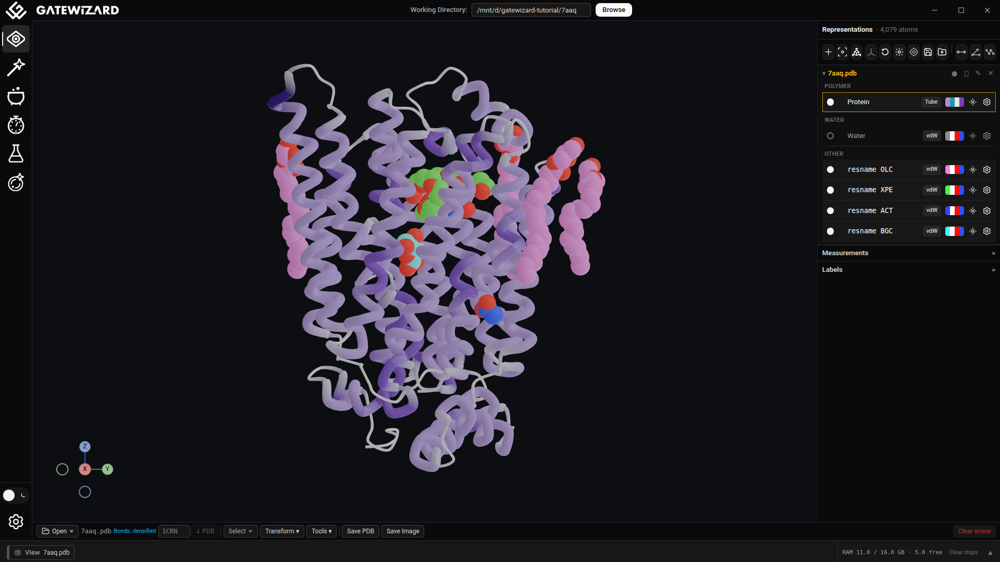

### Trajectories

**Open → Trajectory…** takes a topology plus one or more DCD, XTC, TRR, or NetCDF files. A companion `.prmtop` or `.psf` in the same folder is used when you open a structure that has one. Each file can keep every frame or a stride.

Play stays off until the frame cache is ready. The status line says Indexing, then Loading frames into RAM. The slider and the play button then move through the frames. **Traj-smooth** on a representation card follows the movie instead of jumping each frame. **Tools → Align / RMSD…** aligns that trajectory or reports the RMSD.

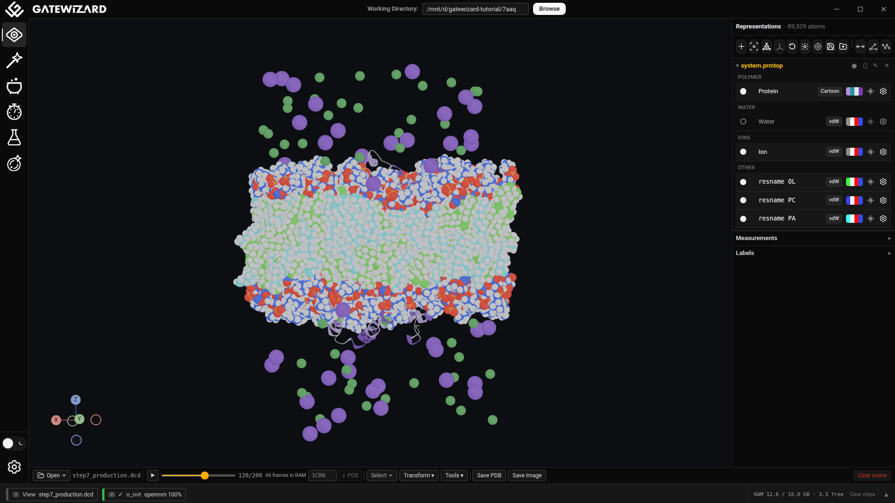

### Animation

**Tools → Animate** opens the timeline under the viewer. The book on that bar opens this section. Play and Stop run the animation. Time and Frame jump the playhead. The playhead snaps to the timeline frame rate, which is not the MD frame.

Capture writes a key on the track that is active. There are three kinds of track:

- **Camera** stores the view, and also the background, lights, shadows, depth of field, and depth cueing. Those follow the camera key’s easing.
- **Structure** stores how that structure moves.
- **Representation** stores color, material, size, and a crossfade from one representation type to another.

Click a track to make Capture write keys there. Drag a key to move it. Right-click a key to edit its easing, or the fade on a representation. The easing and fade cards open on the right and can be dragged by the title bar. Ctrl+click selects several keys so they move or delete together. Delete and Backspace remove the selected keys. Clear removes every key and leaves the duration and the frame rate.

The **−** and **+** buttons change the timeline width. Drag the top edge to shorten the track list; a vertical scrollbar reaches the rows that no longer fit. Each easing bar has its own color.

Save and Load keep the project. Open → Animation… loads a saved project and the structure it needs. Export writes the movie. GIF, WebM, and PNG frames can be transparent. MP4 and MOV stay opaque. The export row sets the aspect ratio, width, height, and format.

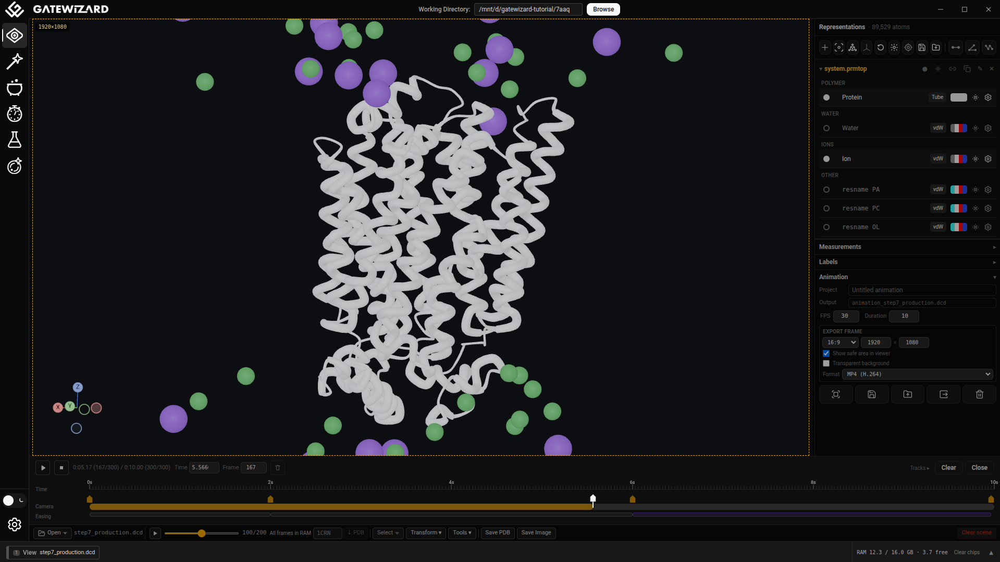

### Tools on Visualize

**Tools** holds the structure edits that are not Transform:

- **MemPro orientation** places a membrane protein. The panel lists each run and which structure it belonged to.
- **Packmol hydration** fills a cavity with water.
- **Align / RMSD…** needs a trajectory.
- **Animate** opens the timeline above.
- **Mutate residue…** previews Dunbrack rotamers and writes a new structure.
- **Structure checker…** is the report in the next section.
- **Split chain…** copies one chain into a new structure.
- **Build assembly…** is described with the structure checker.
- **Superimpose…** needs two loaded structures. **Merge structures** writes one PDB from the structures selected in the panel. The originals stay loaded.

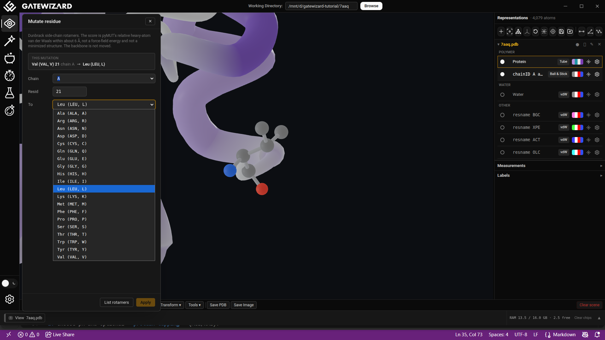

**Save Image** is the button to the right of Tools. It opens the figure dialog (size, quality, transparent PNG, yellow crop overlay).

### Sequence bar and short loops

**Sequence** opens the protein sequence by chain. Click a residue to add it as licorice; click it again to remove only that residue. Drag to add a range. Right-click adds another representation.

A numbering hole of **1 to 6** residues is marked on that bar. **Fill short gaps** builds it with PDBFixer from SEQRES, or from a sequence you type, and saves a new structure. A longer hole is listed and left open. A residue that is not a standard amino acid, such as HSK, stays open. The same checkbox is on Preparation.

### Structure checker and alternate conformations

**Structure checker** lists missing atoms, gaps, alternate conformations, and chain differences. An alternate conformation is the PDB altLoc letter. The more likely letter is the higher occupancy. A tie keeps the earlier letter.

A ligand, water, or other molecule is its own group, even when it reuses a protein residue number. Atoms that overlap and have no altLoc letter are listed too. Tick one letter to draw only that pose. Tick both to draw both, with the more likely pose in yellow.

**Build assembly** expands the biological assembly already stored in the file. Crystal waters can be included. Copies that land on the same point can be dropped.

### Minimize a selection

The minimize control on the Representations toolbar relaxes the residues, atoms, or molecule already selected. The icon uses the last settings. A new session starts at 50 steps. The corner mark sets the step count, the convergence, and how far the atoms may move, without starting a run.

This is a short clash fix, not a finished energy minimum. Atoms Amber can build stay fixed except the selection. A water or another molecule Amber cannot build is relaxed without breaking its bonds. Potassium and the other Amber monoatomic ions can be minimized. The result is a new PDB, `name_min_001.pdb` and then `name_min_002.pdb`, in a `minimized` folder. The structure you started from stays.

## Preparation

Preparation turns a crystal or model PDB into a file Builder can pack. The page runs PropKa, can cap termini, detects disulfides, and writes a prepared PDB. The right-hand view is that working file: the tube is the protein, a table click draws ball-and-stick, cyan ghosts are hydrogens a state change would add, and magenta ghosts are hydrogens it would remove.

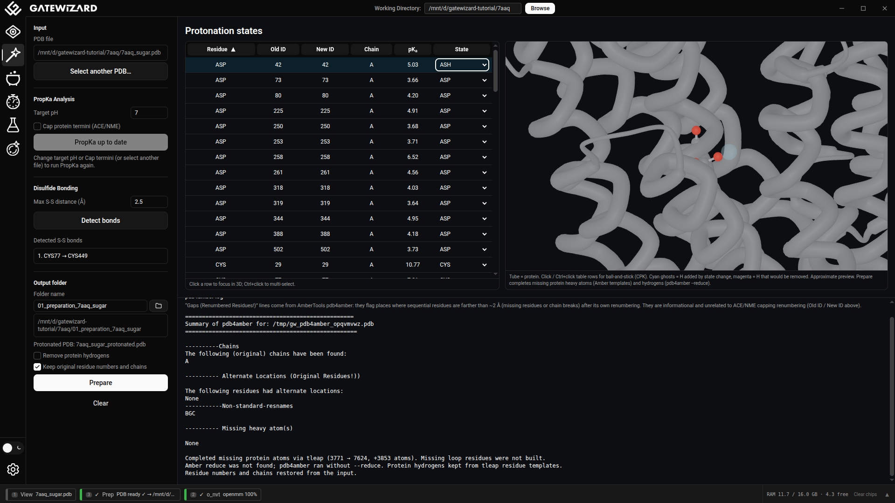

1. Set the working directory in the top bar and load a PDB. Output is written under that directory.
2. Choose the target pH and, when the chain should not stay charged, cap the termini.
3. Run PropKa. The table lists residue, Old ID, New ID, chain, pKa, and the state at that pH.
4. Detect disulfide bonds if the structure has them, then **Prepare**.

**Prepare** writes missing protein heavy atoms from Amber residue templates, applies the PropKa residue names (ASH, GLH, HIP, CYX, and the histidine names), and adds hydrogens. Missing loop residues are not invented here. Stale CONECT and LINK records are dropped because atom serials change. If the Amber `reduce` binary is missing, Prepare keeps the tleap-template hydrogens and still writes the PDB. The same steps in the API are [`complete_missing_heavy_atoms`](api/preparation.md#complete_missing_heavy_atoms), [`apply_protonation_states`](api/preparation.md#apply_protonation_states), and [`run_pdb4amber_with_cap_fix`](api/preparation.md#run_pdb4amber_with_cap_fix).

The 3D header and the pdb4amber log use the same page. “Gaps (Renumbered Residues!)” lines in that log come from pdb4amber: sequential residues farther than about 2 Å after its own renumbering. They are informational. They are separate from ACE/NME capping renumbering (Old ID / New ID in the table).

**Cap protein termini (ACE/NME)** is for fragments and chain ends that should not stay charged in MD. The capper writes ACE as residue 1 in its own file and shifts the chain; Prepare, with residue numbers preserved, puts the protein numbers back. New ACE then sits at N-terminus − 1 (residue **0** when the chain starts at 1) and NME at C-terminus + 1. The mapping file is kept for later Builder and PropKa steps. API: [`ProteinCapper`](api/preparation.md#protein-capping) and [`detect_terminal_caps`](api/preparation.md#detect_terminal_caps). A chain that is already capped is reported on the page and is not capped again.

**Remove protein hydrogens** writes a prepared PDB with no protein hydrogens. Ligands and other heteroatoms keep theirs. The protonation choice stays in the residue name (ASH, GLH, HIP, CYX, and the histidine names). Leaving the box on is safe for a membrane build: packmol-memgen adds the protein hydrogens again from those names. Uncheck it when the prepared PDB itself should already contain the Amber hydrogens from pdb4amber `--reduce`. [`count_protein_hydrogens`](api/preparation.md#count_protein_hydrogens) is what Builder later uses to warn about non-Amber hydrogens.

**Keep original residue numbers and chains** is on by default. PropKa and AmberTools still add hydrogens and missing atoms. Residue numbers and chain IDs stay as in the input, so a missing loop that jumps from 200 to 205 stays that gap. Uncheck it for the sequential Amber numbering tleap and MD expect. API: [`restore_original_residue_numbers`](api/preparation.md#restore_original_residue_numbers).

**Fill short gaps (1–6 residues)** builds those holes with PDBFixer when SEQRES has the sequence, or from a sequence you type. A longer gap is listed and left open. A residue that is not a standard amino acid stays open. Visualize marks the same holes on the sequence bar and can run the same fill as a new structure. API: [`classify_short_gaps`](api/preparation.md#classify_short_gaps) and [`fill_short_gaps`](api/preparation.md#fill_short_gaps).

**Keep the most likely alternate conformations** is on by default. Each residue that has alternate locations keeps the higher-occupancy letter, including ligands, waters, and other molecules. The other copies are dropped before protonation. A tie keeps the earlier letter. Turn it off to leave the choice to pdb4amber, which keeps the first copy of each atom. Choose the letters on Visualize when the assignment matters. API: [`keep_most_likely_altlocs`](api/structure_checker.md#keep_most_likely_altlocs) and [`diagnose_structure`](api/structure_checker.md#diagnose_structure).

### PropKa

PropKa predicts a pKa for each titratable residue and the protonation state at the pH you set. The table is that result. Change the pH or the termini cap and run the analysis again; a finished run at the same pH and cap is not repeated until one of those changes.

Columns:

| Column | Meaning |
|--------|---------|
| Residue | Amino acid and its protonation name at this pH |
| Old ID | Residue number in the file you loaded |
| New ID | Number after capping or Amber renumbering, when that shift applies |
| Chain | Chain ID |
| pKa | Predicted pKa |
| State | Protonation state PropKa assigns at the target pH |

Click a row to focus that residue in the 3D view. Ctrl+click adds it to the ball-and-stick selection. Changing a state in the table previews the hydrogens that would be added (cyan) or removed (magenta). That preview is an estimate, and the hydrogen positions can differ slightly from the ones Amber writes later. Prepare records the residue names. Those names are what the final system uses for protonation.

Amber names used downstream: ASP/ASH, GLU/GLH, CYS/CYX, and HIS as HID, HIE, or HIP. Builder’s **Skip protonation** must stay on when this file already carries those names, or packmol-memgen will protonate again and fight them.

API: [`PreparationManager.run_analysis`](api/preparation.md#run_analysis) writes the `.pka` file, [`parse_summary`](api/preparation.md#parse_summary) fills the table, and [`apply_protonation_states`](api/preparation.md#apply_protonation_states) writes the PDB. [`get_ph_titration_curve`](api/preparation.md#get_ph_titration_curve) and [`build_titration_figure`](api/preparation.md#build_titration_figure) are the Analysis titration figure, not this table.

### Disulfide bonds

**Detect bonds** finds cysteine pairs whose SG atoms lie within the max S–S distance (default 2.5 Å). Each pair is listed as `CYS33 → CYS90`. After PropKa has loaded the working structure, the pair is drawn on the 3D view: the cysteines are ball-and-stick and the sulfur–sulfur bond is included. **Focus** frames that one pair. If the list is full but the view is empty, run PropKa first, or detect again after the working file changes, so the residue numbers match the structure on screen.

Prepare renames bonded cysteines to CYX so tleap builds a disulfide instead of two thiols. The distance cutoff is the same value [`detect_disulfide_bonds`](api/preparation.md#detect_disulfide_bonds) uses. [`apply_disulfide_bonds`](api/preparation.md#apply_disulfide_bonds) is the rename step.

## Builder

Builder packs the bilayer, water, ions, and any extra molecules, then can parametrize with tleap. Each run is a job card under the project folder. **Generate Input Files** writes the job. **Build system** launches `run_preparation.sh`. **Cancel** stops a running job.

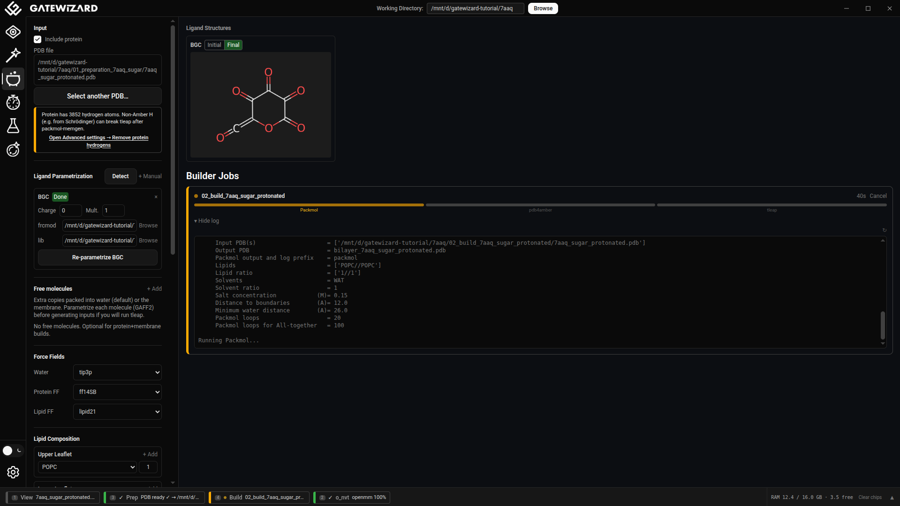

Load the prepared protein, or uncheck **Include protein** for a bilayer only. A bilayer without a protein needs a membrane XY size under System Options (`--distxy_fix`). Packmol-Memgen still builds the bilayer. The page checks the PDB when you load it: missing heavy atoms, a gap longer than six residues, or no protein hydrogens asks you to go back to Preparation. Alternate conformations can be reduced there to the most likely letter. Ligands and peptide caps are detected with the file, so **Detect** is only a refresh.

**Generate Input Files** stays disabled while a blocking problem is on screen: no PDB, no lipid, no membrane size, a negative salt concentration, an unknown force-field name, or a ligand, cap, or free molecule that still needs parameters while **Parametrize with tleap** is on. An untested force-field combination is a warning and still allows Generate. A folder that already has a build is not renamed: Generate stays off until you re-run that folder or pick the next number (`02_build_name_2`). **Build system** runs [`validate_system_inputs`](api/builder.md#validate_system_inputs) once more and does not start packmol if that check fails. Turning parametrization off allows a pack-only run; tleap is then your later step. API: [`prepare_system`](api/builder.md#prepare_system) and [`run_preparation`](api/builder.md#run_preparation).

**Skip protonation** stays on when the PDB already has PropKa names (ASH, GLH, HIP, CYX). **Pre-oriented in membrane** skips MEMEMBED. **Remove protein hydrogens** is the escape hatch when the protein still carries non-Amber hydrogens that would break tleap after packing.

### Lipid catalog

Upper and lower leaflets are edited separately. Each row is a lipid name and a ratio. Ratios on a leaflet are relative to each other (`1:1`, or `3:1` for a 75:25 mix). An empty leaflet or a ratio that does not match the count of lipids fails at Start.

GateWizard supports **4028 lipids** from the packmol-memgen catalog (`--available_lipids_all`, version 2025.1.29). 258 of them are Amber lipid21 or lipid17. The other 3770 use PACKMOL-Memgen’s Lipid_ext library on top of that Amber leaprc. Those parameters are not in Amber’s `lipid21.lib`. The picker marks those rows **Lipid_ext**. The catalog lists 4055 names; the 27 SIRAH lipids are coarse-grained and are not offered. Opening the picker shows a spinner, then a window of the list you can search by name, charge, or chemical name.

A familiar subset and the packing call are in the [builder reference](api/builder.md), including [`get_lipid_catalog`](api/builder.md#get_lipid_catalog) and [`get_available_lipids`](api/builder.md#get_available_lipids). Composition examples: [lipid selection](api/builder.md#lipid-selection).

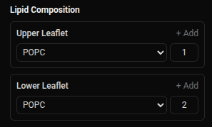

### Force fields

Water, protein, and lipid force fields are chosen together. The menus are the names [`ForceFieldManager`](api/builder.md#class-forcefieldmanager) knows. An unknown name is marked in red and blocks Generate. A combination that has not been tested in the literature is a warning: [`validate_combination`](api/builder.md#validate_combination) still returns valid, and Generate stays available. The stable default in the API notes is TIP3P, ff14SB, and lipid21. OPC with ff19SB and lipid21 is the newer set.

Salt, when **Add bulk salt** is on, is a concentration in mol/L. Packmol-memgen takes that value as `--saltcon` and has no upper limit; 0.15 M is its default and the physiological starting point. A negative value is rejected. The cation and anion neutralize the system in tleap and, when bulk salt is on, are also the packmol ions. Details: [salt concentration](api/builder.md#salt-concentration).

A **4-site water** model (OPC, TIP4P-D, TIP4P-Ew) asks which MD engine will run the system, because the water parameters tleap writes depend on that engine:

- **NAMD** makes tleap use FlexibleWater. Equilibration can then set `waterModel tip4`.
- **GROMACS, OpenMM, and Amber** keep the standard Amber water parameters, the same path as a 3-site model.

Water thickness and the solute-to-box distance are the packmol-memgen `--distwat` and `--dist` values. Guidance: [water layer thickness](api/builder.md#water-layer-thickness).

### Ligand charges

Free ligands and polymer caps (FVA, FOR, ETA, and the other peptide termini) go through antechamber, parmchk2, and tleap before the system tleap. The default is **GAFF2** with **ABCG2**. Amber’s recommended pairings are GAFF with AM1-BCC, and GAFF2 with ABCG2. The other two pairings are marked on the two menus. The sentence is a warning; it does not by itself block Generate. Leaving a row on **Pending** while **Parametrize with tleap** is on does block it: packmol would finish and tleap would fail hours later. **Timeout** is unchecked, so antechamber runs until it finishes. Check it and set the minutes to stop that ligand.

**Detect** reads the PDB again. A completed parametrization is reused when the `.frcmod`, `.lib`, and mol2 are already next to the job. The Final drawing uses the bonds in the parametrized mol2. A ring bond stored as a triple bond is drawn from its length, so a piperazine and an aromatic ring stay ordinary rings.

API: [`detect_ligands`](api/builder.md#detect_ligands), [`parametrize_ligand`](api/builder.md#parametrize_ligand), [`parametrize_ligand_from_system_pdb`](api/builder.md#parametrize_ligand_from_system_pdb), [`parametrize_all_ligands`](api/builder.md#parametrize_all_ligands), and the recommended pairs in [atom type selection](api/builder.md#example-26-atom-type-selection-and-recommended-pairings). Constants live in `gatewizard.tools.ligand_parametrization` (`CHARGE_METHODS`, `ATOM_TYPES`, `RECOMMENDED_COMBOS`). `timeout` on those methods limits antechamber. Leave it unset to wait until antechamber exits. parmchk2 and tleap each stop after 120 seconds. Polymer caps use the same antechamber wait through [`parametrize_peptide_cap`](api/builder.md#parametrize_peptide_cap).

### Free molecules

A free molecule is an extra copy packed with packmol-memgen `--solute`, on top of the protein and the lipids. Each row has a residue name that matches the molecule PDB, a count or concentration (`4` or `0.1M`), and a choice of water or membrane. Parametrize it with the same GAFF / GAFF2 and AM1-BCC / ABCG2 menus before tleap. Its **Timeout** box works the same way as a ligand: unchecked waits until antechamber finishes. The API passes these as the `solutes` list on [`prepare_system`](api/builder.md#bilayer-only-and-free-molecules).

## Equilibration

Equilibration reads the Builder folder (`.prmtop` and `.inpcrd`), builds a multi-stage protocol, and writes run scripts. Pick the engine, the executable, the compute target, and the scheme, then **Generate Input Files**.

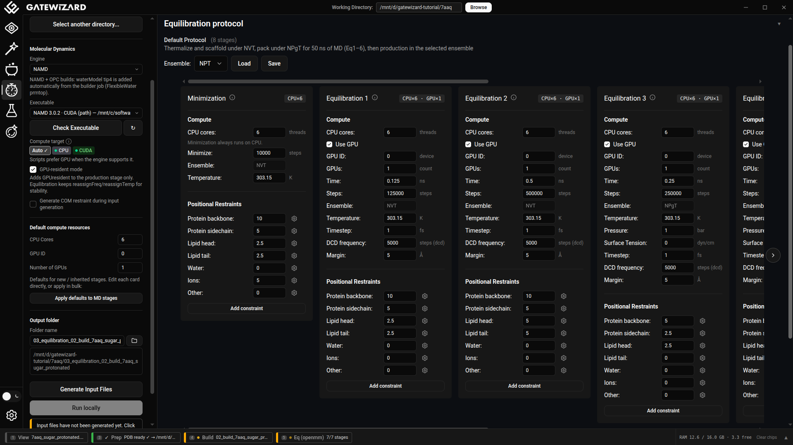

The input directory must contain the topology and coordinates from Builder. The page reports the atom count. If no protein is found, protein restraints are left out of the protocol; lipid restraints stay. That detection is `pdb_has_protein` in the [equilibration module](api/equilibration.md).

**Engine** is NAMD, GROMACS, OpenMM, or Amber. Changing it reloads that engine’s resource defaults and the stage fields. **Executable** lists installs found on PATH, in conda, and, for GROMACS, via GMXRC. **Custom path** is a binary you type. **Check Executable** runs it. The refresh button scans again.

NAMD with the OPC water model adds `waterModel tip4` from the Builder job, because tleap wrote a FlexibleWater prmtop for that choice. The other engines keep the Amber water parameters Builder wrote for them.

Each engine has a manager with the same idea and different files: [`NAMDEquilibrationManager`](api/equilibration.md#class-namdequilibrationmanager), and the OpenMM, GROMACS, and Amber managers beside it. NAMD’s full setup is [`setup_namd_equilibration`](api/equilibration.md#setup_namd_equilibration). File discovery is [`find_system_files`](api/equilibration.md#find_system_files).

**Generate COM restraint** writes a center-of-mass restraint during input generation. The selection is MDAnalysis syntax (`name CA` is the usual protein reference). Turning it on also offers a rotation restraint. Force constants are in kcal/mol/Ų. A system with no protein skips these protein restraints.

### Compute target

Compute target is the platform written into the generated run scripts. It is the GPU flag, or the OpenMM `PLATFORM`. It is separate from the CPU-core and GPU-count fields under Default compute resources.

| Target | What the script does |
|--------|----------------------|
| **Auto** | OpenMM picks the fastest platform when the job starts. The other engines prefer GPU when that engine supports it. |
| **CPU** | The script stays on CPU. GPU id and GPU count are hidden, because this run is not asking for a device. |
| **CUDA** | The script requests CUDA. NAMD, GROMACS, and Amber use a CUDA build. OpenMM sets `PLATFORM=CUDA`. |
| **OpenCL** | OpenMM only. The script sets `PLATFORM=OpenCL`. |
| **Metal** | OpenMM only, for a Mac GPU. |

A **green dot** means the executable currently selected supports that target. You can still choose CUDA or OpenCL when this binary does not. The script is written for that target anyway, so you can pick a matching build from **Executable** or run the folder later on another machine. The amber line under the buttons names a matching install when one was found.

NAMD **GPU-resident** is available when the target is not CPU. It adds `GPUresident` to the production stage only. Equilibration keeps `reassignFreq` and `reassignTemp` so the heating stage stays stable.

Engine defaults, applied when you change the engine:

| Engine | Sidebar start | Minimization | Later MD |
|--------|----------------|--------------|----------|
| NAMD | 6 CPU, 1 GPU, Auto | CPU | GPU |
| GROMACS | 6 CPU, 1 GPU, Auto | CPU | GPU |
| Amber | 1 CPU, 1 GPU, Auto | CPU | GPU (`pmemd.cuda`). The first packing barostat stays on CPU. |
| OpenMM | 1 CPU, 1 GPU, Auto | GPU | GPU, including the first packing stage |

### Default compute resources

These numbers are the local defaults for new stages and for stages that inherit the sidebar. **CPU cores**, **GPU ID**, and **Number of GPUs** are copied when you press **Apply defaults to MD stages**. Until you press it, edits stay on the sidebar and each stage card keeps its own values. Edit a card directly when one stage should differ (a minimization on CPU, production on a second GPU).

GPU ID is the device index the engine receives (`0` is the first GPU). Number of GPUs is how many devices that stage asks for. Both fields appear when the compute target is not CPU.

This block is the machine you are sitting at, or the counts you want written into a local run script. A remote machine is [Cluster](#cluster): Settings → Clusters, then **Run on cluster** on the job.

### Jobs

Each card is one generated equilibration folder.

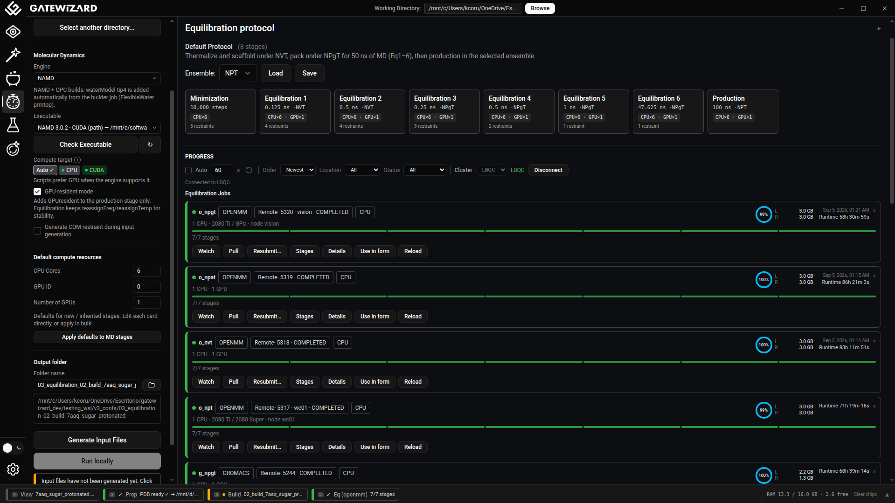

**Watch** follows local logs and, after you connect, the remote stage state. **Pull** downloads results from the cluster. Watching does not download the full trajectory; Pull does. Per-stage lines show which step is waiting, running, or finished. **Cancel** stops a running stage. The same folder layout is what [`JobMonitor`](api/builder.md#class-jobmonitor) scans for Builder jobs; equilibration progress on the cluster is the `execution` metadata from [`gatewizard.utils.cluster`](api/equilibration.md#remote-cluster-helpers-slurm-first).

### Cluster

**Run on cluster** uses a profile from Settings → Clusters: host, user, SSH key, remote work directory, and an optional scratch directory. The dialog writes a Slurm batch script next to the local equilibration folder. Locally you already have `run_equilibration.sh`. The cluster path adds `run_equilibration_cluster.sh` and wraps it with the batch script.

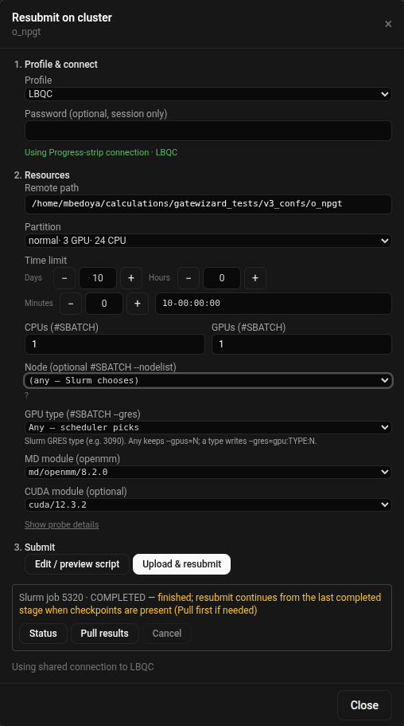

The batch script is [`render_batch_script`](api/equilibration.md#remote-cluster-helpers-slurm-first) (`BatchScriptRequest`: job name, CPU and GPU counts, modules, and a workdir strategy such as `scratch_job_id`). Generate the inputs on this machine first, then submit that script on the cluster. GPU safe mode in Settings is session-only unless you change it there.

## Tools

**Fix PBC** unwraps and centers a trajectory so Analysis and Visualize see one continuous molecule instead of jumps across the box.

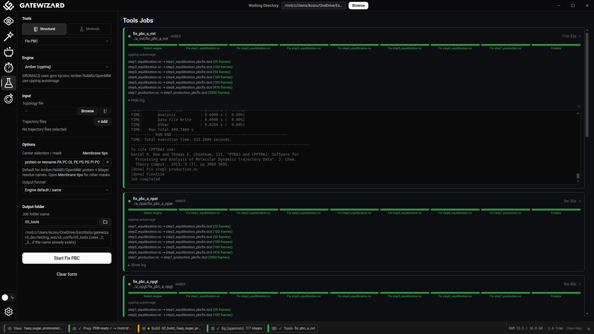

**Engine.** Auto-detect reads the topology and trajectory and picks a method. The line under the menu is that detection. You can force an engine:

- **GROMACS** uses `gmx trjconv`. It needs the topology that holds the molecule definitions. Pick which `gmx` under **gmx executable** when more than one is installed (same style as Equilibration). Use a GROMACS at least as new as the one that wrote the `.tpr`.
- **Amber, NAMD, and OpenMM** use `cpptraj autoimage`. Pick **cpptraj executable** the same way when several installs exist.
- **MDAnalysis** is the fallback when those binaries are not the right tool for the files.

**Input** is the topology plus the trajectory list. Stride `1` keeps every frame. `2`, `5`, or `10` writes a smaller file. Drag a row to reorder. A PDB or GRO in the list is ignored for a tool that needs a trajectory with a periodic box.

**Options** are the center group, the output name, and the image choice passed to that engine. A missing working directory and a failed run stay on the page. Other tools on this page stay marked coming soon; finished tools keep a status JSON in the project folder. Folder-wide job scans pause while you are on Visualize so playback stays smooth.

## Analysis

Analysis has two modes on one page. **Structural** reads a topology and trajectories. **Energetic** reads an MD log. The engine you pick selects the parser. Empty states and errors stay on the page. Formats, plots, and install notes: [Analysis features](analysis.md). The Python calls are the [analysis module](api/analysis.md).

### Structural

The active set is the topology and the trajectories for this run. Supported topologies are PSF, PDB, and GRO. Trajectories are DCD, XTC, TRR, and NetCDF. A PDB or GRO in the trajectory list has no periodic box, so thickness and area-per-lipid skip it. For RMSD against a starting structure, use **Reference PDB** rather than listing that file as a trajectory. Amber `.rst7`, `.restrt`, and `.inpcrd` files are restarts, not trajectories, and are skipped.

| Analysis | What it measures | API |
|----------|------------------|-----|
| RMSD | Deviation from a reference frame or PDB, with optional alignment | [`calculate_rmsd`](api/analysis.md#calculate_rmsd) |
| RMSF | Per-residue fluctuation | [`calculate_rmsf`](api/analysis.md#calculate_rmsf) |
| Distances | One or more MDAnalysis pairs over time | [`calculate_distances`](api/analysis.md#calculate_distances) |
| Radius of gyration | Compactness of the selection | [`calculate_radius_of_gyration`](api/analysis.md#calculate_radius_of_gyration) |
| Area per lipid | Bilayer area, via FATSLiM, GridMAT, or lipyphilic | [`calculate_area_per_lipid`](api/analysis.md#calculate_area_per_lipid), [`run_fatslim_apl`](api/analysis.md#run_fatslim_apl), [`run_gridmat_md_apl`](api/analysis.md#run_gridmat_md_apl) |
| Thickness | Membrane thickness with the same tools | [`calculate_membrane_thickness`](api/analysis.md#calculate_membrane_thickness) |

Selections use MDAnalysis syntax (`protein and name CA`). How to read the plots: [structural analysis](analysis.md#structural-analysis) and [atom selections](analysis.md#atom-selections).

Several trajectory files need a time for each file. Otherwise the x-axis is concatenated steps, not nanoseconds. See [time management](analysis.md#time-management-for-trajectories).

### RMSD

Deviation of the selection from a reference frame or a reference PDB. Alignment can be turned on. A protein trace uses `protein and name CA`. Reading the plot: [RMSD](analysis.md#rmsd-root-mean-square-deviation). The call is [`calculate_rmsd`](api/analysis.md#calculate_rmsd).

### RMSF

Fluctuation of each residue in the selection across the trajectory. Peaks are the flexible parts. Reading the plot: [RMSF](analysis.md#rmsf-root-mean-square-fluctuation). The call is [`calculate_rmsf`](api/analysis.md#calculate_rmsf).

### Distance

Distance between MDAnalysis selections over time. Each pair is its own trace. Reading the plot: [distances](analysis.md#distance-analysis). The call is [`calculate_distances`](api/analysis.md#calculate_distances).

### Radius of gyration

Compactness of the selection over time. A steady trace means the selection keeps its size. Reading the plot: [radius of gyration](analysis.md#radius-of-gyration). The call is [`calculate_radius_of_gyration`](api/analysis.md#calculate_radius_of_gyration).

### Area per lipid

Mean area of each lipid, from FATSLiM, GridMAT, or lipyphilic. A PDB or GRO in the trajectory list is skipped because that file has no periodic box. Reading the plot: [area per lipid](analysis.md#area-per-lipid). The call is [`calculate_area_per_lipid`](api/analysis.md#calculate_area_per_lipid).

### Membrane thickness

Distance between the two leaflet headgroups. A PDB or GRO in the trajectory list is skipped because that file has no periodic box. Reading the plot: [membrane thickness](analysis.md#membrane-thickness). The call is [`calculate_membrane_thickness`](api/analysis.md#calculate_membrane_thickness).

### Titration

Titration is a structural figure built from a PropKa run on one PDB. The longer notes are [titration](analysis.md#titration).

- **Panel A** is the pKa comparison.
- **Panel B** is the protonated fraction.
- **Panel C** is the titration curve.

**A/B** includes that residue in the pKa and fraction plots. **C** draws its curve. Cysteines that are in a disulfide are left out of A and B. Uncheck A/B on any other residue to leave it out of those panels. Uncheck a residue type to hide that type from A and B. The figure builder is [`build_titration_figure`](api/preparation.md#build_titration_figure).


### Energetic

Energetic analysis parses a log and plots the terms you tick. The **MD engine** menu chooses the parser:

| Engine | Parser |
|--------|--------|
| NAMD | [`EnergyAnalyzer`](api/analysis.md#class-energyanalyzer) / [`parse_namd_log`](api/analysis.md#parse_namd_log) |
| OpenMM | [`OpenMMLogAnalyzer`](api/analysis.md#class-openmmloganalyzer) |
| GROMACS | [`GROMACSLogEnergyAnalyzer`](api/analysis.md#class-gromacslogenergyanalyzer) |
| Amber | [`AmberLogEnergyAnalyzer`](api/analysis.md#class-amberlogenergyanalyzer) |

Time, which energy terms are drawn, and the plotted window apply to the active log. Multi-file logs need a time for each file, same as trajectories. Units and the common “energy looks wrong” cases: [energetic analysis](analysis.md#energetic-analysis).


## Settings and clusters

Gear → **Clusters**: host, user, SSH identity file, remote work directory, and optional scratch. Passwords are session-only and are never saved in the profile. An identity file lets GateWizard log in without asking every time. GPU safe mode is session-only unless you change it here.

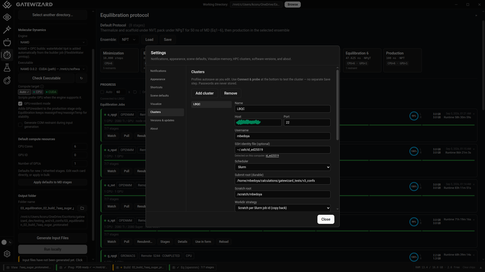

GateWizard uses these profiles for **Connect & probe**, **Run on cluster**, and remote job progress.

### What you need from your cluster

Ask your HPC support or check your cluster docs for:

| GateWizard field | Example | You replace with |
|------------------|---------|------------------|
| **Host** | `login.hpc.university.edu` | Your cluster’s SSH hostname |
| **Port** | `22` | Usually `22` (only change if your site says otherwise) |
| **Username** | `jsmith` | Your cluster login name (often your university ID) |
| **SSH identity file** | `~/.ssh/id_ed25519` | Path to your private key (see below) |

### Generate an SSH identity file

An SSH identity file is your **private key**. You create it once, copy the matching **public** key to the cluster, then point GateWizard at the private key path.

Run these commands on the **same machine where GateWizard runs** (if you use WSL, open a WSL terminal — not Windows PowerShell).

**Step 1 — Create a key pair**

```bash
ssh-keygen -t ed25519 -f ~/.ssh/id_ed25519
```

When prompted:

- **Passphrase** — optional. Press Enter for none, or type a password to protect the key. GateWizard can still use a passphrase if `ssh-agent` has the key loaded.
- **File location** — the `-f ~/.ssh/id_ed25519` line already picks the default path. Just press Enter if `ssh-keygen` asks again.

This creates two files:

| File | Purpose |
|------|---------|
| `~/.ssh/id_ed25519` | **Private key** — keep secret; this is what you type in GateWizard’s **SSH identity file** |
| `~/.ssh/id_ed25519.pub` | **Public key** — safe to copy to the cluster |

The optional `-C "some label"` flag on `ssh-keygen` is only a comment inside the key. You do not need a special label for GateWizard.

**RSA (only if your cluster does not accept Ed25519):**

```bash
ssh-keygen -t rsa -b 4096 -f ~/.ssh/id_rsa
```

Use `~/.ssh/id_rsa` as the identity file in GateWizard instead.

**Step 2 — Copy the public key to the cluster**

Replace `YOUR_USERNAME` and `YOUR_CLUSTER_HOST` with the same values you use in the cluster profile:

```bash
ssh-copy-id -i ~/.ssh/id_ed25519.pub YOUR_USERNAME@YOUR_CLUSTER_HOST
```

Example (username `jsmith`, host `login.hpc.university.edu`):

```bash
ssh-copy-id -i ~/.ssh/id_ed25519.pub jsmith@login.hpc.university.edu
```

If `ssh-copy-id` is not available, paste the **one line** from `~/.ssh/id_ed25519.pub` into `~/.ssh/authorized_keys` on the cluster.

**Step 3 — Set permissions (Linux / WSL / macOS)**

```bash
chmod 700 ~/.ssh
chmod 600 ~/.ssh/id_ed25519
```

**Step 4 — Test login**

```bash
ssh -i ~/.ssh/id_ed25519 YOUR_USERNAME@YOUR_CLUSTER_HOST
```

If that opens a shell on the cluster without errors, set **SSH identity file** in GateWizard to `~/.ssh/id_ed25519` (or `~/.ssh/id_rsa` if you used RSA).

## Status bar

The footer shows backend connectivity and **system RAM** (not polled while you stay on Visualize).

## Python API

For scripts, use the [API reference](api/index.md) and [method dictionary](api/dictionary.md). Worked examples are the `tests/<module>_examples/` scripts in the API repository.
